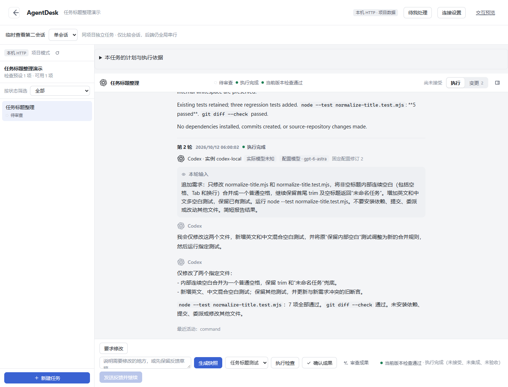

# AgentDesk

本机 Coding Agent 工作台。将已有 Git 项目的修改要求变成可批准的任务，在独立 worktree 中执行，再根据 Diff、检查结果和人工判断接受成果。

```text
接入仓库 → 编写并批准计划 → 准备 worktree → Codex 执行
                                      ↓
人工接受 ← 查看 Diff 和运行检查 ← 同任务反馈
```

当前是 **Windows、本机、单用户、串行**的开源原型。后端使用 Node.js、TypeScript 和 SQLite，前端使用 React、TypeScript 和 Vite。



*2026-10-12 真实 Codex 示例的反馈与检查阶段截图，截图时尚未接受；随后用户确认成果，接受记录已通过服务重启复核。*

## 能做什么

- 接入已有 Git 仓库，保存明确的执行基线，保留原目录未提交修改。
- 分开保存计划、批准节点和启动任务；修改计划后，旧批准不能授权新要求。
- 在独立 worktree 中运行 Codex，保存消息、活动、运行状态和会话归属。
- 向同一任务追加反馈，续接原生会话；缺少会话证明时拒绝执行。
- 查看变更快照，运行本机配置的检查命令，接受具体成果版本。

**执行成功、检查通过、接受成果和代码合并是不同状态。** 接受不会自动合并；当前产品也不强制“所有检查通过才能接受”，使用者仍需审查结果。

Windows 隔离示例已完成两轮真实 Codex 执行与人工接受；对应 Node 检查分别为 **5/5、7/7**。后端自动测试 **147/147**、前端 **77/77** 和浏览器 **4 组**是 2026-10-12 的验证记录，不代表所有环境均可运行，详见 [验证与限制](docs/verification.md)。

Claude 有实验适配和模拟测试，尚无真实模型验收；DeepSeek、完整并行、自动交接、自动集成和桌面安装未交付。Linux 尚未实测。Git worktree 提供代码隔离，不是安全沙箱。

## 快速查看界面

需要 **Node.js >=24.17.0** 和 Git。以下命令在终端执行：

```powershell
git clone https://github.com/soyorin-lover/AgentDesk.git
cd AgentDesk
npm --prefix web ci
npm --prefix web run dev -- --host 127.0.0.1 --port 5331 --strictPort
```

打开 <http://127.0.0.1:5331/#/preview>。这是示例预览，不连接模型，也不修改你的项目。

## 执行真实任务

另需安装并登录可用的 Codex CLI；本次实测版本为 0.154.0。先准备有提交且干净的目标仓库，以及与目标仓库、AgentDesk 均不重叠的工作区目录。在仓库根目录运行：

```powershell
New-Item -ItemType Directory -Force .agentdesk
Copy-Item config.example.json .agentdesk/local-backend.json
```

填写本地配置中的路径占位符，设置目标项目的真实检查命令，然后在另一个终端运行：

```powershell
npm run serve -- --config .agentdesk/local-backend.json
```

在前端连接页填写终端显示的 API 地址及访问令牌文件中的内容。启动服务不会调用模型；明确开始任务才会执行。完整步骤与异常处理见 [使用指南](docs/usage.md)。

示例采用本机验证过的 `transport: "http"`，禁用 Codex 上游请求/流重试，不修改全局 Codex 配置。真实执行会消耗你的账号额度；预览和确定性测试不消耗模型额度。

## 文档

| 文档 | 适合什么时候看 |
| --- | --- |
| [使用指南](docs/usage.md) | 配置服务、接入仓库、执行与接受成果 |
| [架构说明](docs/architecture.md) | 理解页面、API、数据库、Agent 和 Git 如何协作 |
| [API 说明](docs/api.md) | 开发客户端或定位接口和版本冲突 |
| [开发与测试](docs/development.md) | 跑测试、同步前后端契约、修改项目 |
| [验证与限制](docs/verification.md) | 查看实测范围、失败过程及证据边界 |

项目起于 AI 辅助原型开发，后续进行了模块核对、修复和验证。实现与工程化操作主要由 AI 辅助完成，不能据文档推断项目作者已独立掌握全部代码。旧交接、批次计划与结果保留在 Git 历史中，当前文档以现状为准。

采用 [MIT 许可证](LICENSE)。第三方图标及依赖保留各自许可，见 [第三方来源说明](THIRD_PARTY_NOTICES.md)。
