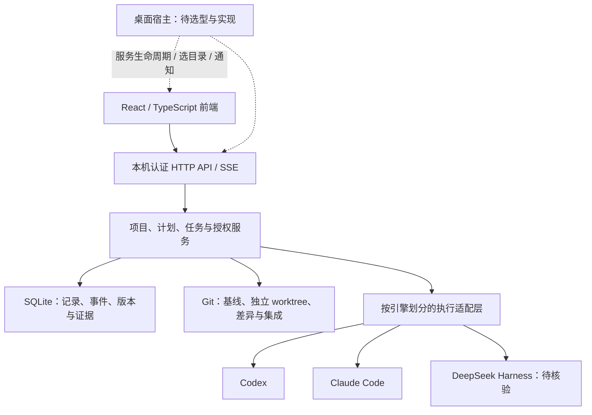

# AgentDesk 项目方案

版本：V1.0  
日期：2026-10-11  
用途：统一产品目标、核心体验、技术边界、分批开发与交付标准。本文整理已确认方向并提出后续实施建议，不代表全部功能已实现，也不自动启动后续开发。

## 1. 项目概述

AgentDesk 是面向独立开发者的个人 Coding Agent 开发工作站。用户围绕一个项目安排多个 Agent，通过项目蓝图组织任务，在任务工作台查看执行、提出修改要求、审查成果，最后将确认的代码集成并验收。

产品需要始终回答三个问题：

1. 哪个 Agent 负责什么？
2. 工作到了哪一步，依据是什么？
3. 我现在需要处理什么，点击后会发生什么？

用户保留决策权。Agent 可以提出方案、执行已批准任务和整理交接材料；软件负责保存授权、执行记录、代码版本与检查证据。

### 目标用户与使用场景

首要用户是使用 Coding Agent 开发个人项目的独立开发者；也适用于求职作品、开源工具和小型产品的持续迭代。首版按单用户、本机运行设计，不建立团队协作和多租户系统。

典型场景包括：从零规划项目、接入已经开发中的 Git 仓库、给不同 Agent 分配开发任务、在原任务中持续反馈、审查并接受成果、安排后续任务以及汇总最终交付。

### 项目价值

把分散在多个工具窗口中的目标、会话、代码和执行依据关联起来，减少遗漏与重复说明。对于作品展示，重点展示从需求、分工、执行到验证交付的工程过程，而不是仅展示生成代码或聊天界面。

## 2. 产品范围

### 首版完整产品目标

| 模块 | 用户得到什么 |
| --- | --- |
| 项目管理 | 创建项目空间，接入已有仓库，确认代码基线与未提交改动的处理方式 |
| 项目蓝图 | 通过流程图或层级树安排任务、执行者、前置关系和状态 |
| AI 策划 | 在独立项目会话中讨论目标，将建议转为可编辑、可审阅的候选计划 |
| 计划批准 | 保存与批准分开，支持明确的整批或部分批准 |
| Agent 执行 | 按实际引擎能力准备工作区、下发任务和精确续接 |
| 任务工作台 | 查看逐轮会话、执行活动、异常、反馈和改动依据 |
| 成果审查 | 查看 Diff 和真实检查证据，要求修改或接受具体成果版本 |
| 显式交接 | 审阅接收对象、成果摘要、版本与未解决事项后再发送 |
| 并行与集成 | 在隔离工作区开发，经确认将具体成果集成到专用分支并联合检查 |
| 本机交付 | Windows/Linux 使用，提供启动、通知、退出与数据保留的完整体验 |

Codex、Claude Code、DeepSeek Harness 是首版目标引擎，逐个接入与验证。不能因为它们都属于 Coding Agent，就假定启动、输入、中止、审批和恢复能力完全一致。

### 暂不纳入

多用户权限、云端协同、计费、完整 IDE、模型训练、无人工批准的自主调度、自动发布和自动解决所有合并冲突。代码编辑与深入调试继续使用外部 IDE/终端。

### 开发策略

完整首版分成多个可验收批次。先交付可实际使用的单任务闭环，再补规划、多引擎协作、并行、集成与桌面体验。分阶段交付不改变完整产品目标，也不将未来功能包装成已完成。

## 3. 核心用户流程

### 3.1 创建或接入项目

打开软件进入项目首页。新建项目先填写名称与说明，不要求先配置角色、成员或负责人。

接入已有项目时，检查 Git 分支、完整 HEAD、未提交改动和 worktree，用户确认基线后再安排任务。导入不重置、自动提交或覆盖已有代码；新 worktree 不默认包含原目录未提交修改。

从零创建目录和系统选目录属于目标体验，必须由真实宿主能力支持。当前网页仅能创建项目空间和使用已有路径检查，不假装已创建代码目录。

### 3.2 讨论与建立计划

进入项目后默认展示蓝图。用户可以手动新建任务，也可以打开右侧策划面板讨论项目目标。

策划聊天中的建议不是正式计划。生成候选后，用户检查任务内容、执行者、依赖与验收条件；保存草稿和批准计划分别进行。批准不等于创建执行记录或启动任务。

### 3.3 下发与执行

单击节点，在右侧核对任务说明、执行者、依赖与基线。条件满足后，按实际接口显式创建执行记录、准备独立工作区。

点击「下发任务」后，确认本次执行的任务、Agent、工作区和代码基线，再写入启动请求。请求接受后留在蓝图，以真实服务状态显示进展，用户可自行进入任务工作台。

当前服务仍全局串行，没有队列。忙碌时明确说明暂不能执行，不能展示虚假的「排队中」。未来队列必须先有可靠的后端持久化、取消与状态查询能力。

### 3.4 反馈与修改

双击节点或点击明确入口进入任务工作台。输入区统一用于反馈和修改要求，发送方式由真实能力决定：

- 本轮结束且具备精确续接能力：继续原任务会话。
- 执行中且实际支持实时输入：发送到当前运行。
- 执行中但不支持实时输入：保留待发送草稿，不声称送达。
- 状态或会话归属未知：禁止发送，先核查已有记录。

只依据结构化执行事实展示待回复事项，不从普通聊天文字猜测审批或问题状态。

### 3.5 审查、确认与继续

执行结束后，用户审查具体快照、文件 Diff 与真实检查记录。不满意则带反馈继续原任务；满意则接受当前成果版本。

以下事实分别记录，不能合成一个「完成」按钮：

| 事实 | 含义 |
| --- | --- |
| 执行成功 | 本轮执行得到明确成功终态 |
| 检查通过 | 对某一具体代码版本运行的真实检查通过 |
| 成果已接受 | 用户认可当前具体成果版本 |
| 节点已确认 | 用户确认节点满足当前计划的完成条件 |
| 已集成 | 指定代码版本已进入目标集成分支 |
| 最终验收 | 项目满足交付条件，并保留验收依据 |

依赖满足只表示后续任务具备相应条件，不代表自动启动。交接和集成均需明确操作与证据。

## 4. 页面与交互方案

采用三层结构：**项目首页 → 项目工作区 → 任务工作台**。设置和待我处理作为辅助入口。

### 项目首页

展示项目入口、首次使用空状态和来自真实数据的待处理事项。新建入口明确；没有数据支持时，不编造任务数、进度或健康状态。

### 项目工作区

蓝图占据主要空间，支持依赖图与层级树。默认节点展示任务名、执行者和状态；内部标识、绑定和修订放入必要详情。

单击节点打开右侧详情，双击或明确按钮进入工作台。详情、编辑、策划面板互斥、可收起；适合的区域可调宽。设置、历史与高级配置按需展开。

### 任务工作台

以会话和反馈为主，成果审查、检查、工作区依据按需切换或展开。默认查看单个任务，可临时比较另一个会话；比较不代表已有并行执行能力。

返回保留蓝图选中、位置、缩放、会话阅读位置和输入草稿。跨刷新/退出的持久恢复是后续需要补齐的产品能力，当前内存记忆不等于长期恢复。

### 视觉原则

浅色、安静、现代、适合长时间使用。用层级与留白组织信息，颜色用于真实状态与需要处理的问题。文案说明「可以做什么」「会发生什么」「为什么暂时不能做」，避免让用户先理解内部组织结构。

关键画面先评估再扩展，不一次铺满未来场景，不沿用未获认可的 gallery 评审外框。

## 5. 技术架构方案

沿用现有工程，不从零重写、不因方案文档迁移目录。

图中的桌面宿主、DeepSeek 和集成等包含目标设计，不表示当前均已实现。

| 层 | 方案与责任 |
| --- | --- |
| 前端 | React、TypeScript、现有 Vite 工程；负责交互、状态呈现和能力门禁 |
| 公共客户端 | 冻结版本的类型与 API 封装，升级时核对配套文件与哈希 |
| 应用服务 | Node.js、TypeScript；统一项目归属、版本、批准、幂等与执行条件 |
| 持久化 | SQLite 保存任务、运行、事件、计划修订、批准、快照与接受依据 |
| 代码工作区 | Git worktree 隔离任务代码，基线固定，已有任务不随 HEAD 推进偷换代码 |
| 执行适配 | 使用引擎官方结构化协议，保留原生会话归属，不解析 TUI 文本作为核心接口 |
| 桌面宿主 | 后续单独决定技术选型，负责本机服务、目录选择、通知、退出和安装 |

### 核心数据关系

项目包含计划修订和任务；计划节点指定任务目标、执行者与依赖。批准绑定明确修订和节点。执行任务固定实例配置、代码基线与工作区，任务下有多个运行轮次和事件。成果快照、检查、接受和节点确认关联具体版本。

编辑计划遵循现有 B07 规则：任意编辑产生新修订，撤销旧修订全部后续批准；历史任务和代码保留。新修订重新批准后，显式创建新任务，不改写活动任务输入。

### 可靠性与边界

写请求使用显式版本与幂等键，不盲目重试未知结果。未知执行保留隔离，不能自动重放模型请求；恢复会话不等于恢复进程。支持 Windows/Linux 的路径与子进程参数，不依赖固定盘符、Bash 或 Unix 信号。

worktree 只隔离代码，不是安全沙箱；并行还需隔离端口、数据库、配置和依赖资源。凭据、运行数据库、原始敏感日志与 node_modules 不进入版本库。

## 6. 当前项目基础与缺口

以下依据截至 2026-10-10 的批次交付记录，不是本方案重新执行的验收结果。源码能力、在线服务版本、真实模型证据和产品交付分别判断。

| 领域 | 已有基础 | 尚未完成或未验证 |
| --- | --- | --- |
| 项目与 Git | 项目空间、仓库检查、确认基线、受信执行绑定、独立 worktree | 系统选目录、创建代码目录、完整接入向导与宿主 |
| 计划 | 手动节点、层级/DAG、修订、整批/部分批准、节点确认 | 真实 AI 策划会话与结构化候选生成 |
| Codex | 执行适配、原会话反馈、历史真实探针证据 | 当前组合的成品级真实模型与跨平台验收仍需分批安排 |
| Claude Code | B08b 源码适配 start/精确 continue，fake transport 验证 | 真实模型/工具权限/Linux 验收；前端仍冻结 B08a，未升级 |
| DeepSeek Harness | 已纳入产品目标 | 协议、产品版本、适配与真实能力核验 |
| 执行与审查 | 串行执行、事件、Diff 快照、真实有界检查、接受与失效依据 | 队列、并行、完整未知执行恢复 |
| 前端 | F04 基础及交互 V1 首批：首页、蓝图面板、任务工作台与真实接口路径 | 审美评估、持续使用体验、跨刷新草稿与位置恢复 |
| 交接与交付 | 有任务、代码、快照与接受依据 | 显式交接、专用分支集成、联合检查与最终验收流程 |
| 成品运行 | 本机 Web 开发与 fixture 环境 | 安装、自动启动服务、通知、后台/退出、升级备份与双平台验证 |

因此，当前阶段适合描述为：**已具备执行与审查的工程基础，正在把已有能力整理为可理解、可持续使用的个人工作站。** 不按代码量推断完成百分比。

## 7. 后续分批路线

以下是建议路线，按每批验收推进；不是已经批准并开始执行的全部任务。桌面生命周期方案应尽早设计，但选型和实现另批进行。

| 阶段 | 重点交付 | 验收出口 |
| --- | --- | --- |
| A：核心体验定型 | 评估并调整首页、蓝图、详情/编辑和工作台；补少量关键体验缺口 | 用户能独立完成进入项目、安排任务、下发、反馈和审查，不依赖解释内部术语 |
| B：实例与多引擎 | 受信配置的可用设置路径；受控同步 B08b、真实 Claude 验证；独立核验 DeepSeek | 每个引擎有自己的能力矩阵与证据，未验证操作禁用，旧任务不被迁移或改绑 |
| C：真实策划 | 独立项目策划会话、结构化候选、校验、编辑、保存与批准 | 聊天建议不直接执行；用户能从讨论形成明确批准的计划 |
| D：明确交接 | 接收对象、成果摘要、代码版本、接口约定和未解决问题 | 交接可审阅、可追溯；不伪装跨引擎迁移原生会话 |
| E：受控并行 | 执行位/队列、并发限制、资源隔离、取消与未知结果处理 | 至少两个任务的代码和运行资源真实隔离，无重复执行或误报状态 |
| F：集成与验收 | 已接受成果进入专用分支，冲突处理、联合检查与交付记录 | 可完整复现执行、接受、节点确认、集成、检查和最终验收依据 |
| G：可安装交付 | 桌面宿主、自动服务、目录选择、通知、退出、备份和安装文档 | Windows/Linux 干净环境实测，日常不要求手动服务地址或内部令牌 |

并行与交接的具体先后可根据真实依赖调整，但不能借调整省略授权和证据。每批明确前端、后端、公共契约和根配置的修改责任；接口未就绪时保留清晰隔离的预览。

## 8. 验收与测试策略

### 功能验收

用一个小型真实 Git 项目贯穿流程：接入并确认基线 → 建立任务与依赖 → 批准 → 下发 → 查看反馈 → 提出修改 → 审查快照与检查 → 接受 → 节点确认 → 交接 → 集成 → 最终验收。

单任务阶段先验证对应子链路；未实现环节明确标缺口。多引擎与并行必须在各自真实能力就绪后验证，不用 fixture 代替真实引擎或双平台证据。

### 质量要求

用户每次看到的操作应有明确结果和阻塞原因。未批准不执行，旧版本不偷换，未知结果不假成功，历史记录不丢失。没有检查记录时显示未检查，没有实际模型证据时显示未知。

### 控制测试成本

开发中优先类型检查和改动路径的少量验证。为授权、会话归属、幂等、版本冲突和代码隔离等高价值行为保留回归测试，不新增镜像实现测试或大型重复 E2E。每批收尾做一次必要的完整检查；仅在新改动、失败或未解决问题出现时补验受影响部分。

真实模型验证单独限定范围和额度；不为普通界面修改重复调用模型。结果报告标明模式、命令、证据、未验证能力和下一批交接。

## 9. 主要风险与处理

| 风险 | 处理方式 |
| --- | --- |
| 页面越来越多，用户仍不知道怎么操作 | 以三层主路径评审，每屏只突出当前主要动作 |
| 不同引擎能力差异造成误导 | 能力由受信实例与运行事实返回，逐引擎逐动作验证 |
| 计划改动使授权过期，历史任务难理解 | 明确提示影响，新修订显式重建任务，保留历史只读 |
| 未提交改动或错误基线影响代码 | 只读检查与显式确认，不自动重置、提交或覆盖 |
| 并行任务争用资源、集成冲突 | 先设计隔离与占用规则，再开放并行；集成失败保留可诊断状态 |
| 服务退出、断连、额度耗尽导致未知结果 | 持久化记录，禁止自动重放，提供核查与安全恢复路径 |
| 测试和模型调用消耗过高 | 用确定性fixture验证流程，真实调用只覆盖必要能力 |
| 开发预览被当作可安装产品 | 分别标注预览、源码能力、联调、真实执行和成品验收 |

## 10. 项目交付物

完整项目最终应包括可安装应用或明确的交付包、可追溯源码版本、配置与安装文档、引擎能力矩阵、核心流程演示、平台验收报告和数据备份/恢复说明。

作品演示建议围绕一个连续故事：用户接入项目、让策划助手提出方案、安排不同Agent、处理一次修改与异常、确认成果并完成集成验收。演示中的真实结果与预览必须区分，避免使用未经执行的进度、检查数量或模型身份。

## 11. 本方案依据

- [产品范围](PRODUCT.md)
- [已确认产品与工作流](PRODUCT-DECISIONS-2026-10-09.md)
- [前端交互设计 V1](FRONTEND-INTERACTION-V1-2026-10-10.md)：页面与操作方向优先依据
- [跨聊天交接](HANDOFF.md)：最新批次状态入口
- [B08b API 与能力边界](BACKEND-BATCH-08B-API.md)
- [B08b 结果](CODEX-BATCH-08B-RESULTS.md)
- 前端独立工程 `docs/FRONTEND-INTERACTION-V1-RESULTS.md`：交互首批结果与验证范围

本方案是对现有方向和实施建议的汇总。用户新的产品决定、平台权限、已发布契约及实际代码事实优先；旧文档中的历史阶段与分工不覆盖更新后的约定。
