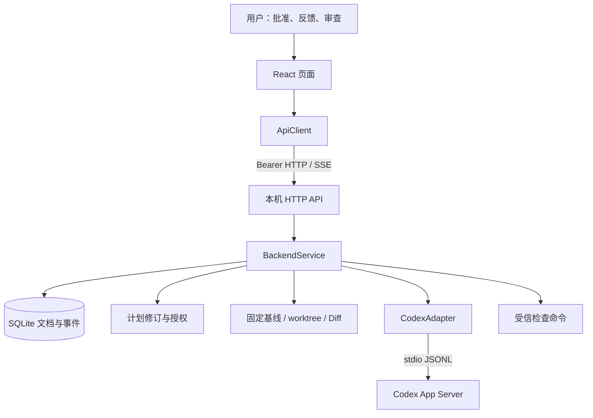

# 架构说明

Vite 提供 React 前端，Node.js 提供 HTTP API、SQLite 持久化和 Agent/Git 协调，两个本机进程分别启动。Git 保存代码与基线，数据库保存任务和证据；接受记录不自动改变来源仓库。

## 模块入口

| 模块 | 职责 | 代码 |
| --- | --- | --- |
| 启动 | 配置校验、实例登记、HTTP 和本地令牌 | [serve.ts](../src/serve.ts) |
| HTTP | Host/Origin/Bearer 校验、路由与 SSE | [http.ts](../src/backend/http.ts) |
| 应用协调 | 任务、运行、工作区、快照、检查和接受 | [service.ts](../src/backend/service.ts) |
| 计划授权 | 修订、节点批准、受管任务、依赖与确认 | [workflow-service.ts](../src/backend/workflow-service.ts) |
| 来源与绑定 | 仓库检查、受信来源、固定 commit | [repository-import.ts](../src/backend/repository-import.ts)、[execution-bindings.ts](../src/backend/execution-bindings.ts) |
| 工作区 | 创建和复核任务 worktree | [projects.ts](../src/backend/projects.ts) |
| 变更 | Diff、内容摘要与完整性 | [repository.ts](../src/backend/repository.ts) |
| 检查 | 参数数组执行、时限、退出与输出上限 | [checks.ts](../src/backend/checks.ts) |
| Codex | 创建/续接 thread、turn、事件和终态 | [adapter.ts](../src/backend/adapter.ts)、[session.ts](../src/codex/session.ts)、[rpc.ts](../src/codex/rpc.ts) |
| 存储 | JSON 文档、事件、事务与租约 | [store.ts](../src/backend/store.ts) |
| 界面 | 项目、蓝图和任务工作台 | [AppV2.tsx](../web/src/v2/AppV2.tsx)、[workflow](../web/src/v2/workflow/)、[live](../web/src/v2/live/) |

SQLite 主要使用 documents 和 events，业务对象按 kind/id 保存为 JSON，不是每个对象一张物理表。private 分类不是加密承诺，运行库可能含任务输入、回复和代码 Diff，不能直接公开。

## 生命周期

**接入与批准。** 项目空间、仓库关联和执行绑定分别保存。检查后确认 commit，执行绑定还须匹配本机受信来源。批准固定计划修订和节点要求，编辑后不能沿用旧批准。

**准备。** Task 固定执行绑定、基线和实例配置。API 先保存意图，再创建 worktree；202 不代表 ready。来源 HEAD 推进不会改变旧任务基线，未提交修改不自动复制进任务。

**执行与反馈。** 每次执行创建一个 Run。首次 thread/start，反馈 thread/resume，再 turn/start。适配器核对 cwd、approvalPolicy、workspaceWrite 和会话归属；缺证据不回退新线程。消息和匹配终态持久化，不从回复文字猜完成。

**审查与接受。** Snapshot 关联最新 Run、Diff 和内容摘要。检查重新比较内容，在 worktree 中执行受信预设。接受要求最新 Run 成功、快照完整且内容一致；当前没有“检查必须通过”的通用强制条件。新执行或外部修改会使旧证据失效。

## 防止串错版本的关联

| 字段 | 用途 |
| --- | --- |
| version / expectedVersion | 防止过时页面覆盖新状态，冲突后重新读取 |
| revision / approvalId | 固定批准的具体计划与节点 |
| executionBinding / baselineCommit | 固定任务来源与 commit |
| agentBinding / nativeSessionRef | 固定实例配置与有归属证明的会话 |
| taskId / runId / snapshotId / contentDigest | 关联检查、接受与具体轮次和内容 |
| Idempotency-Key | 同一写请求重复返回原结果，同键异载荷拒绝 |

摘要只证明内容相同，不证明代码正确。任务 accepted、检查 passed/current、接受 valid 分别有不同含义。详情查询也可能发现磁盘变化并使接受失效，写操作需要重新读取版本。

## 连接与执行边界

全局串行包括模型和检查；未知结果进入 needs_recovery 并阻塞。内部 Promise 链不是用户任务队列，不代表并行调度。

前端通过带 Bearer 的 fetch SSE 按任务和连续序号补读事件，不用原生 EventSource。断流需显式重连，取消浏览器读取不等于中止模型。

前后端公共三文件一致，fixture 启动时比较实际 SHA-256。维护见 [开发指南](development.md)，接口见 [API](api.md)，实测范围见 [验证指南](verification.md)。
