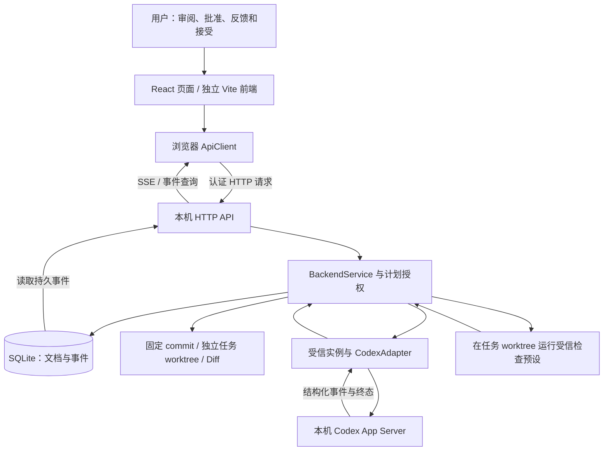

# 首版核心链路：代码核对说明

日期：2026-10-12（Asia/Shanghai）。P2 静态核对，代码基准 `dd65f98`。

只追踪 [首版三个场景](release-scope.md)；没有运行服务、测试或模型。本文的“已定位”表示能找到实现，不代表运行验收通过。历史记录、新静态证据与待运行项分别表述。

## 系统怎样连接

前端和后端是两个进程，当前没有桌面宿主统一管理它们。Git 保存代码与基线，SQLite 保存任务、运行及审查记录；数据库中说“已接受”不会自动把任务代码合并回原仓库。

## 页面操作怎样到达后端

| 真实页面操作 | 控制层 → API 方法 | 路由 |
| --- | --- | --- |
| 项目首页创建/编辑 | [ProjectPortal](../web/src/v2/projects/ProjectPortal.tsx) → [ProjectController](../web/src/v2/projects/state.ts) → createProject/updateProject | POST / PATCH `/projects` 或 `/projects/:id` |
| 检查并确认已有仓库 | ProjectController → inspectProjectRepository/confirmProjectRepository | POST `/projects/:id/repository-inspections`、`/repository` |
| 授予项目执行绑定 | [BindingController](../web/src/v2/projects/binding.ts) → bindProjectExecution | POST `/projects/:id/execution-binding` |
| 编辑、批准、建立执行任务 | [WorkflowPage](../web/src/v2/workflow/WorkflowPage.tsx) → [WorkflowController](../web/src/v2/workflow/state.ts) → saveWorkflow/approveWorkflow/linkWorkflowTask | POST `/projects/:id/workflow`、`/workflow-approvals`、`/workflow-tasks` |
| 准备工作区和首次下发 | [NodeDispatch](../web/src/v2/workflow/NodeDispatch.tsx) → [useLiveSession](../web/src/v2/live/session.ts) → prepareWorkspace/startRun | POST `/tasks/:id/workspace`、`/runs` |
| 在工作台发送反馈 | [LiveWorkbench](../web/src/v2/live/LiveWorkbench.tsx) → useLiveSession → startRun(input) | POST `/tasks/:id/runs` |
| 查看成果、执行检查和接受 | LiveWorkbench → useLiveSession → snapshot/startCheck/accept | POST `/tasks/:id/snapshots`、`/checks`、`/accept` |
| 确认蓝图节点 | WorkflowController → confirmWorkflowNode | POST `/projects/:id/workflow-confirmations` |

表中路由均以 `/api/v1` 为前缀，省略后缀的路径沿用同一 project/task ID。方法来自浏览器 [ApiClient](../web/src/v2/api/client/api.ts)，对应服务端 HTTP 路由，不能据页面按钮名称直接推断执行已完成。

[AppV2](../web/src/v2/AppV2.tsx) 将 `#/preview`、`#/demo` 分流；真实 HTTP 连接成功后由 [ConnectionPage](../web/src/v2/ConnectionPage.tsx) 进入 ProjectPortal。示例预览与确定性替身不等于真实 Codex 接入。任务工作台通过实例能力、availableActions、固定授权、连接状态与版本共同决定按钮是否可用，后端仍会再次检查。

任务工作台先读取服务与任务事实，按序号补读历史事件，再使用带 Bearer 的 fetch SSE 读取增量；不是原生 EventSource。事件 reducer 校验任务身份与连续序号，按同一规则重放历史和增量。断流会提示 disconnected，需要显式重连；取消浏览器读取不等于中止模型。刷新后重新查询持久事实，不承诺跨退出保存所有视图位置和草稿。

## 模块职责和入口

| 模块 | 职责 | 实现入口 |
| --- | --- | --- |
| 服务启动 | 读取本机配置、登记实例、打开应用服务、启动本机 HTTP | [src/serve.ts](../src/serve.ts) |
| HTTP | Host/Origin/Bearer 校验，路由、JSON 请求与 SSE 事件输出；写操作要求幂等键 | [http.ts](../src/backend/http.ts) `startHttp` |
| 应用协调 | 任务、工作区、执行、快照、检查和接受；协调版本、幂等与后台工作 | [service.ts](../src/backend/service.ts) `BackendService` |
| 计划 | 保存新修订、批准指定节点、建立受管任务、核对批准与依赖、人工确认节点 | [workflow-service.ts](../src/backend/workflow-service.ts) `Workflows` |
| 项目与执行绑定 | 分开处理网页仓库关联、本机受信来源与任务固定 commit | [repository-import.ts](../src/backend/repository-import.ts)、[execution-bindings.ts](../src/backend/execution-bindings.ts) |
| Git 工作区 | 从指定 commit 创建任务分支及 worktree，复核位置、来源和标记 | [projects.ts](../src/backend/projects.ts) `ProjectRegistry.create/verify` |
| 变更快照 | 收集已暂存、未暂存和未跟踪变化，保存 Diff、内容摘要及完整性 | [repository.ts](../src/backend/repository.ts) `captureChanges` |
| 检查 | 用命令与参数数组运行配置好的预设，记录退出、超时、输出及截断 | [checks.ts](../src/backend/checks.ts) `executeCheck` |
| Codex 接入 | 按已保存的原生 thread 建立/续接会话，启动 turn，过滤对应事件并等待匹配终态 | [adapter.ts](../src/backend/adapter.ts)、[session.ts](../src/codex/session.ts)、[rpc.ts](../src/codex/rpc.ts) |
| 数据库 | SQLite 的 documents 保存不同 kind 的 JSON，events 按任务和序号保存事件；提供事务与进程租约 | [store.ts](../src/backend/store.ts) `Store` |

不是“每个业务对象一张数据库表”：当前物理表主要是 documents 和 events。Task、Run、Snapshot 等对象按 kind/id 保存为 JSON。`private` 是存储分类，不是加密承诺；运行库与原始私有记录不能直接公开。

## 场景 1：接入、计划与工作区

1. 创建项目空间只创建组织记录。检查仓库读取分支、HEAD、未提交变化和 worktree 等信息；确认时重新检查指纹，变化后拒绝沿用旧检查。没有 commit 的仓库不能作为确认基线。
2. 确认仓库关联时要求明确承认“未提交改动不纳入”。网页关联还不授予执行能力：`bindProjectExecution` 必须匹配本机配置的受信 grant、来源身份与已确认 commit。
3. 蓝图保存、批准、建立执行任务分别走 workflow、workflow-approvals、workflow-tasks 路由。批准保存具体计划修订和节点输入；保存新修订后旧批准不能授权新操作，不自动改写已执行任务的输入。
4. Task 固定执行绑定 ID/修订/基线 commit 和实例配置。后续来源 HEAD 推进或项目重新绑定，不等于旧 Task 自动换基线。
5. `prepareWorkspace` 先保存 preparing 意图并返回 202，再异步执行 `git worktree add -b ... <固定commit>`。实际创建成功并复核后才是 ready；202 不是工作区已准备好的证明。worktree 共享 Git 仓库，不是 OS 权限沙箱。

定位：`service.ts` 的 `inspectProjectRepository`、`confirmProjectRepository`、`bindProjectExecution`、`prepareWorkspace`；`Workflows.prepareDraft/prepareApproval/prepareLink/assertTask`；`ExecutionBindings.storedFor/validate`。

## 场景 2：下发、事件与反馈

`POST /tasks/:id/runs` 交给 `startRun`：先核对计划授权、忙碌状态、任务版本、实例配置、会话归属和工作区；在事务中保存 Run 与输入，更新 Task，并记录 run.created。随后才启动后台执行，HTTP 202 表示意图已持久化，不代表 Codex 已接到输入或成功。

首次输入由任务目标和验收条件组成。反馈仍调用同一 Task 的 runs 路由，但新建一个 Run，输入是本次反馈。任务、运行轮次和原生会话是三个概念：同一 Task 可以有多个 Run，通过保存的会话引用继续原生会话。

CodexAdapter 每轮启动结构化 App Server 连接，经过 initialize、model/list，再选 thread/start 或 thread/resume，最后 turn/start；通信为子进程 stdio JSONL，不解析 TUI。反馈先核对 Task、worktree、引擎、实例配置与已验证会话归属，缺证据时拒绝另开会话兜底。完成事件必须匹配 thread/turn，应用服务还要确认所持连接退出后才保存确定终态。配置中的模型名称不作为实际物理模型证明；本机新安装版本的兼容性和真实退出时序仍待运行验证。

适配器输出的消息、活动和运行状态被写入 events，再由 HTTP 事件查询/SSE 送回界面；不是从聊天文字猜状态。`#finish` 在确定轮次结束时把任务送到 in_review；未知结果进入 needs_recovery 并保持阻塞，不自动重试。

服务里的 `#queue` 是串行处理应用命令的 Promise 链，不能据此宣称存在用户任务队列。`#busy` 同时检查模型运行和检查任务，包括 needs_recovery；新的执行不能绕过未知结果继续启动。

## 场景 3：Diff、检查与接受

1. `snapshot` 在无活动执行时调用 `captureChanges`，保存 taskId、runId、baseHead/head、contentDigest、Diff 与 completeness。快照是审查证据，不是自动 Git commit；超限、二进制、链接、扫描期间变化等会影响完整性，不能一律当作完整文本审查。
2. `startCheck` 要求快照属于当前任务和最新 Run，并重新核对当前内容摘要。检查在任务 worktree 中运行受信 preset，不接受浏览器随意指定命令。
3. 检查结果有两个维度：status 是 passed/failed 等，validity 是 current/stale。历史检查通过后代码变化，结果仍可查，但不能成为当前代码的有效通过证据。查询会重新核对磁盘、运行轮次和快照关联。
4. `accept` 要求最新 Run succeeded、成果快照完整且当前内容一致，保存 Acceptance 及 task.accepted 事件。当前代码没有“检查必须通过”的强制条件；首版演示仍按 P1 要求先拿到有效检查证据再接受。
5. 新 Run 会使旧接受失效；查询接受摘要也可能发现外部文件变化，持久记录失效并更新任务版本。GET 详情因此并非在所有情况下都无写入副作用；写操作应使用重新查询的版本。
6. 蓝图节点的确认另走 workflow-confirmations，核对有效接受及批准归属。执行成功、检查通过、成果接受、节点确认、代码合并仍是不同事实；本次不实现自动合并。

定位：`service.ts` 的 `snapshot/startCheck/listChecks/accept/queryAcceptance/#invalidate`；`Workflows.prepareConfirmation`。

## 版本和证据怎样避免串错

| 字段/记录 | 回答的问题 |
| --- | --- |
| expectedVersion / version | 页面是否正在修改已经被别人或后台更新过的记录？冲突返回 409，需要重新读取 |
| 计划 revision / approvalId | 批准的是哪一版计划和哪些节点？ |
| executionBinding / baselineCommit | Task 实际在哪个受信仓库和 commit 上工作？ |
| agentBinding / nativeSessionRef | 使用哪个固定实例配置，继续哪个有归属证明的原生会话？ |
| taskId / runId / snapshotId / contentDigest | 检查和接受对应哪个任务、轮次及具体内容？ |
| Idempotency-Key | 同一个写请求重试时是否已记录过？同键同载荷复用已存结果，同键异载荷拒绝；不同键不是同一个重试 |

幂等键与版本校验分别处理“重复请求”和“过时页面”，不是同一个功能。内容摘要帮助识别证据对应的内容，不证明功能正确；仍需有意义的检查和人的审查。

## 前后端版本配套结论

对照当前后端与前端冻结公共文件，SHA-256 和差异核对结果如下：

| 文件对 | 静态结果 |
| --- | --- |
| `src/client/api.ts` 与 `web/src/v2/api/client/api.ts` | 字节一致；SHA-256 `EAC5D2C41B707CFEC3CEF348C07DE0F96404D1E085D21BAD4912AAF2DE53D89D` |
| `src/client/execution.ts` 与 `web/src/v2/api/client/execution.ts` | 字节一致；SHA-256 `8A5207C059409FD1AE3A45C2588D2FEF380282D33420A0D016526969440373AF` |
| `src/backend/types.ts` 与 `web/src/v2/api/backend/types.ts` | 仅两行类型定义不同：后端增加 ModelEvidence.source 的 assistant_message 值，以及 EngineAdapter 的可选 engineId/capabilities；后端哈希 `F4A58760CE0E644C146B141A3CAF6CFD940C1C84ABE8B2729B269F18139417A9`，前端哈希 `A2A87AF620D2547D167DDC509B6727AA0E453ECB241245DD90B239D54C055700` |

首版配套建议：保留交付副本的 B08b 后端，P3 联调批同步前端类型并更新公共文件版本/哈希说明，再验证 Codex 主线；不为保留 B08a 标记而回退整个后端。api.ts/execution.ts 不需要因本次两项类型差异改写。此建议不扩大 Claude 验收范围，也不表示已经完成同步或证明运行时兼容。

旧 fixture 依赖未复制的 B08a/B07 私有冻结快照，不能把公共 API 字节一致当作 fixture 可直接运行的证明。P3 联调批需明确新的 fixture 后端来源并移除本机路径依赖，P4 再验证干净检出；本批不修改这些脚本。

## P3/P4 的核对入口

已有可复用测试包括：项目与固定基线 `tests/backend-batch05.test.ts`、`backend-batch06.test.ts`；计划批准 `backend-batch07.test.ts`；实例和会话 `backend-batch08a.test.ts`；检查及完整链路 `backend-checks.test.ts`、`backend-project-flow.test.ts`。本批只定位，未执行，也不把测试名作为通过证据。

保留 P0 已知的本机路径、依赖声明和 fixture 快照缺口；后续逐批修复，不在架构核对中顺手改功能。Claude 只有历史模拟验收，DeepSeek、并行、交接、自动集成和宿主不在已验证架构主线内。

用户理解记录：本文提供核对后的解释；尚未把用户已阅读、掌握这些代码记作事实，也不据此生成简历能力声明。
